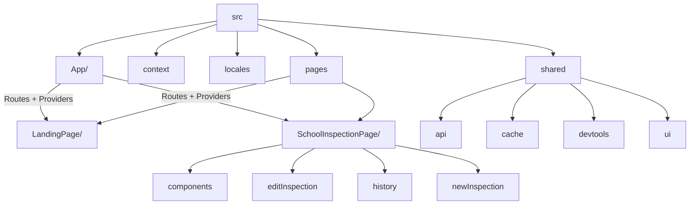

# Welcome to inspector Chalmers - A DHIS2 Platform App

This project was bootstrapped with [DHIS2 Application Platform](https://github.com/dhis2/app-platform).

## Available Scripts

In the project directory, you can run:

### `yarn start`

Runs the app in the development mode.<br />
Open [http://localhost:3000](http://localhost:3000) to view it in the browser.

The page will reload if you make edits.<br />
You will also see any lint errors in the console.

### `yarn test`

Launches the test runner and runs all available tests found in `/src`.<br />

See the section about [running tests](https://platform.dhis2.nu/#/scripts/test) for more information.

### `yarn build`

Builds the app for production to the `build` folder.<br />
It correctly bundles React in production mode and optimizes the build for the best performance.

The build is minified and the filenames include the hashes.<br />
A deployable `.zip` file can be found in `build/bundle`!

See the section about [building](https://platform.dhis2.nu/#/scripts/build) for more information.

### `yarn deploy`

Deploys the built app in the `build` folder to a running DHIS2 instance.<br />
This command will prompt you to enter a server URL as well as the username and password of a DHIS2 user with the App Management authority.<br/>
You must run `yarn build` before running `yarn deploy`.<br />

See the section about [deploying](https://platform.dhis2.nu/#/scripts/deploy) for more information.

## Code Structure Overview

Inspector Chalmers is a DHIS2 Application Platform project (React + HashRouter). `src/App/App.jsx` wires up navigation and wraps every page with `InspectionContext` and `AttributeContext`, enabling shared edit state. Two user-facing journeys exist today: `LandingPage` for search/entry and `SchoolInspectionPage` for history, editing, and new submissions. Shared infrastructure (API hooks, caching, UI primitives) lives under `src/shared`.



```
src/
├── App/                       # Entry point, routes
├── context/                   # Inspection + attribute React contexts
├── locales/                   # Translation bundles/bootstrap
├── pages/
│   ├── LandingPage/          # Home
│   └── SchoolInspectionPage/ # Main view
│       ├── components/       # Org tree, info cards, shared panels
│       │   ├── OrgTreePanel.{jsx,css}
│       │   └── SchoolInfoCard.{jsx,css}
│       ├── editInspection/   # Edit form, delete panel, mutation hooks
│       │   ├── hooks/
│       │   │   ├── useUpdateSchoolInspection.jsx
│       │   │   └── useDeleteSchoolInspection.jsx
│       │   ├── EditInspectionForm.{jsx,css}
│       │   └── DeleteInspectionPanel.{jsx,css}
│       ├── history/          # Analytics APIs, graphs, heatmaps, hooks
│       │   ├── api/          # Analytics fetch hooks/adapters
│       │   ├── components/   # Timeline, tables, analytics panels
│       │   ├── graphs/       # Graph renderers
│       │   ├── heatmap/      # Heatmap + legend components/utilities
│       │   └── hooks/        # Aggregated analytics hooks
│       └── newInspection/    # New inspection form, configs, POST hook
│           ├── components/   # Field widgets (boolean, rating, etc.)
│           ├── configs/      # Form metadata + icon mapping
│           ├── hooks/        # usePostSchoolInspectionEvent
│           └── SchoolInspectionForm.{jsx,css}
└── shared/
    ├── api/                  # API helpers, endpoint docs, tracker hooks
    │   ├── datasetsAPI.jsx
    │   ├── useSchoolsAPI.jsx
    │   ├── useTrackerEventMutation.jsx
    │   └── endpoint_diagram.md
    ├── cache/                # Offline detector, cacheable queries, outbox
    │   ├── cacheableQuery.jsx
    │   ├── useOfflineDetector.jsx
    │   └── useOutboxCount.jsx
    ├── dev-tools/            # Only used for populating mock data to db. Disabled.
    │   └── populateSchoolInspections.js
    └── ui/                   # Shared UI resources
        └── icons/            # SVG icons library

```

**Example flow – editing an inspection**

1. `App/App.jsx` renders `SchoolInspectionPage`.
2. `editInspection/EditInspectionForm.jsx` consumes `InspectionContext`.
3. Update/delete hooks (`hooks/useUpdateSchoolInspection.jsx`, `hooks/useDeleteSchoolInspection.jsx`) call shared API primitives.
4. History visualizations under `history/components` refetch analytics through shared hooks to reflect changes.

For additional architectural detail, see `README.structure.md`.

## Learn More

You can learn more about the platform in the [DHIS2 Application Platform Documentation](https://platform.dhis2.nu/).

You can learn more about the runtime in the [DHIS2 Application Runtime Documentation](https://runtime.dhis2.nu/).

To learn React, check out the [React documentation](https://reactjs.org/).
