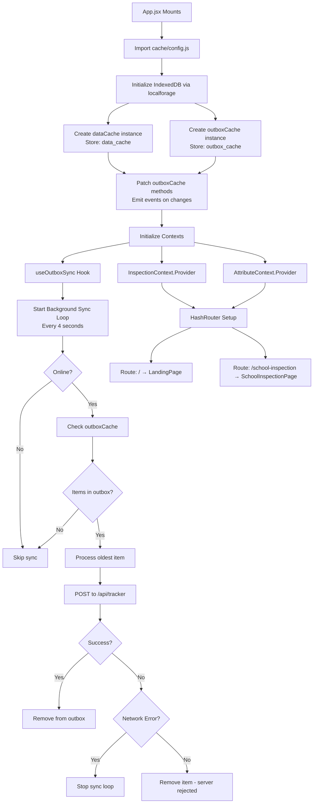
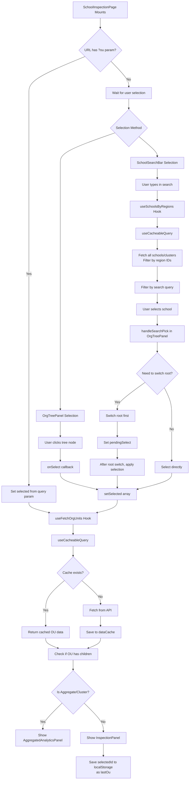
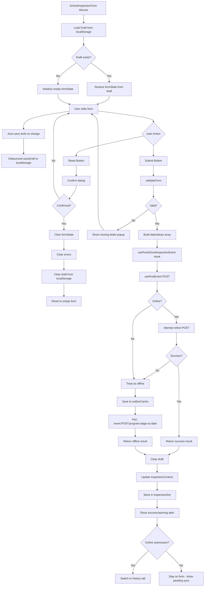
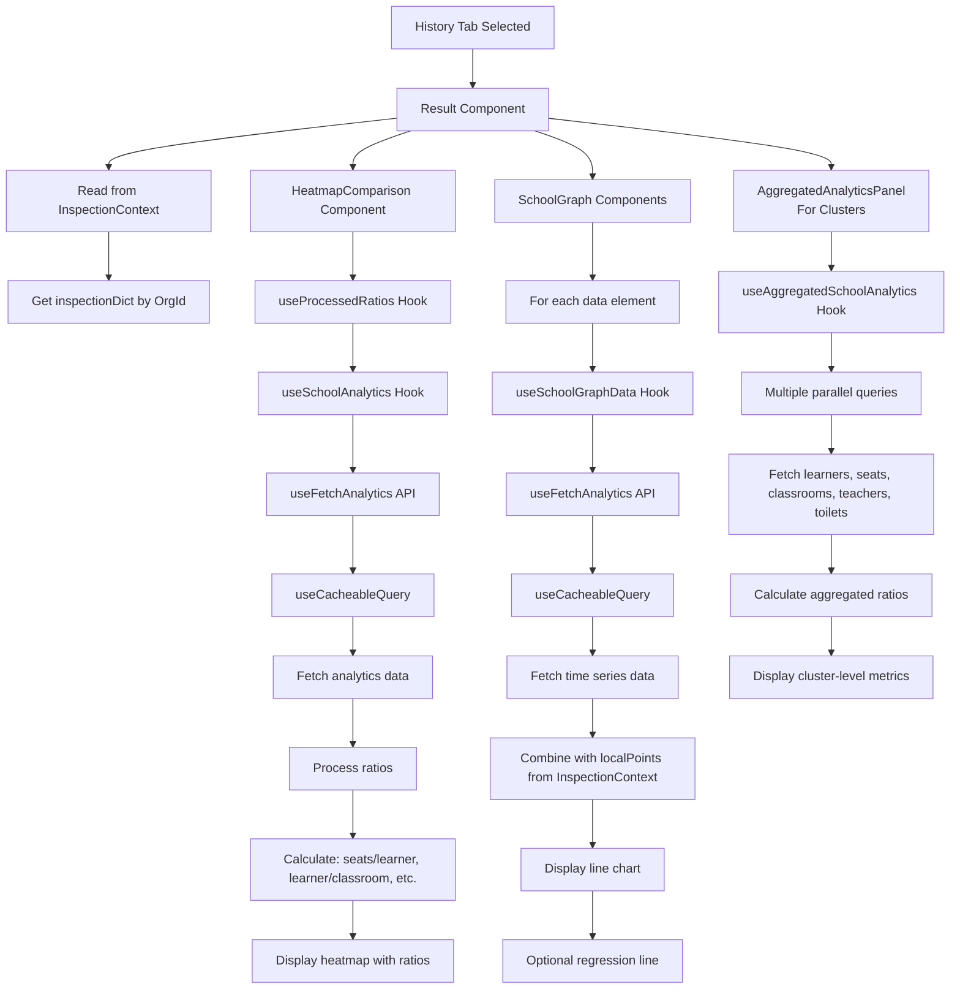
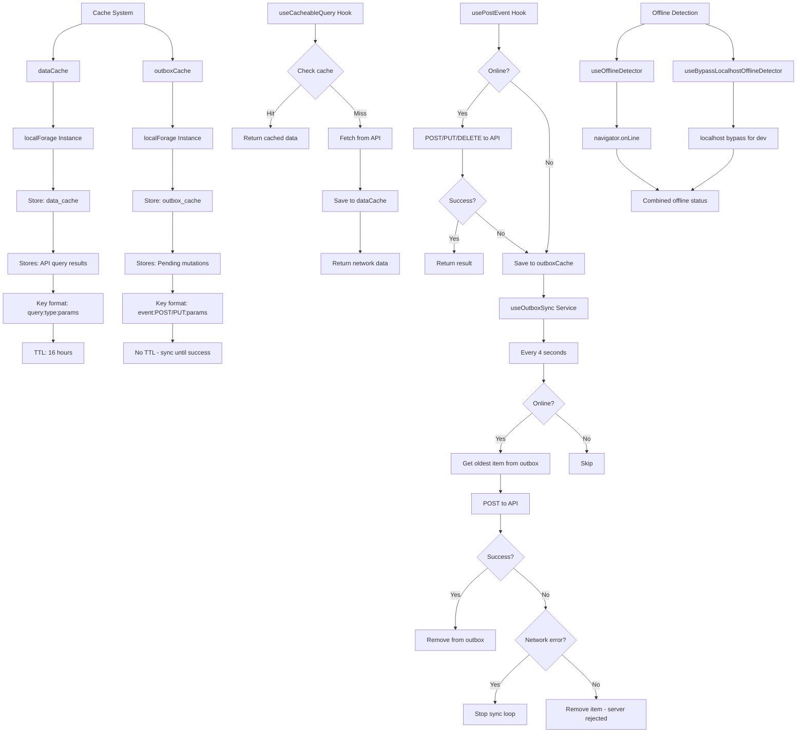

# Welcome to inspector Chalmers - A DHIS2 Platform App

This project was bootstrapped with [DHIS2 Application Platform](https://github.com/dhis2/app-platform).

## Available Scripts

In the project directory, you can run:

### `yarn start`

Runs the app in the development mode.<br />
Open [http://localhost:3000](http://localhost:3000) to view it in the browser.

The page will reload if you make edits.<br />
You will also see any lint errors in the console.

### `yarn test`

Launches the test runner and runs all available tests found in `/src`.<br />

See the section about [running tests](https://platform.dhis2.nu/#/scripts/test) for more information.

### `yarn build`

Builds the app for production to the `build` folder.<br />
It correctly bundles React in production mode and optimizes the build for the best performance.

The build is minified and the filenames include the hashes.<br />
A deployable `.zip` file can be found in `build/bundle`!

See the section about [building](https://platform.dhis2.nu/#/scripts/build) for more information.

### `yarn deploy`

Deploys the built app in the `build` folder to a running DHIS2 instance.<br />
This command will prompt you to enter a server URL as well as the username and password of a DHIS2 user with the App Management authority.<br/>
You must run `yarn build` before running `yarn deploy`.<br />

See the section about [deploying](https://platform.dhis2.nu/#/scripts/deploy) for more information.

## Code Structure Overview

Chalmers is a DHIS2 React Application Platform project. `src/App/App.jsx` handles routing and provides the inspection + attribute contexts used across every page. The app has two main areas: `LandingPage` for search/entry and `SchoolInspectionPage` for viewing history, editing events, and capturing new inspections. 
## App Functionality

Inspector Chalmers is a full offline-capable PWA React application for school inspections. Users navigate through the organizational tree to select schools, view historical inspection data, and submit new inspections or edit existing ones. The app provides aggregate analytics comparing current and previous inspection data across clusters and schools, with graph visualizations and regression analysis.

### Implementation

**Offline Support**: The app implements a comprehensive offline-first architecture using IndexedDB (via `localforage`) for persistent storage. When offline, inspection submissions are queued in an outbox cache (`src/shared/cache/config.js`). The offline detector (`src/shared/cache/useOfflineDetector.jsx`) monitors connection status by checking browser online state, DHIS2 connection status, and server reachability. Data queries use a cacheable query wrapper (`src/shared/cache/cacheableQuery.jsx`) that serves stale cache immediately while fetching fresh data in the background.

**User Experience**: The codebase emphasizes clarity and feedback for users with varying digital literacy. Form validation provides immediate, contextual error messages. Progress indicators show completion status for multi-field forms. Field constraints prevent invalid inputs (e.g., negative numbers, values exceeding limits). Visual signifiers like icons, color-coded states, and clear button labels make actions discoverable. The UI follows DHIS2 design patterns for consistency, using familiar navigation structures and standard components. Loading states and success/error feedback are shown throughout to keep users informed of system status.

### Codebase structure

```
src/
├── App/                       # Routes + top-level setup
├── context/                   # Inspection and attribute contexts
├── locales/                   # Translations
├── pages/
│   ├── LandingPage/          # Landing UI
│   └── SchoolInspectionPage/ # Inspection UI
│       ├── components/       # Org tree + info cards
│       │   ├── OrgTreePanel.{jsx,css}
│       │   └── SchoolInfoCard.{jsx,css}
│       ├── editInspection/   # Edit + delete flows
│       │   ├── hooks/
│       │   │   ├── useUpdateSchoolInspection.jsx
│       │   │   └── useDeleteSchoolInspection.jsx
│       │   ├── EditInspectionForm.{jsx,css}
│       │   └── DeleteInspectionPanel.{jsx,css}
│       ├── history/          # Analytics and trends
│       │   ├── api/          # Data fetchers
│       │   ├── components/   # Timeline + tables
│       │   ├── graphs/       # Charts
│       │   ├── heatmap/      # Heatmap + legend
│       │   └── hooks/        # Aggregated data hooks
│       └── newInspection/    # New inspection flow
│           ├── components/   # Form fields
│           ├── configs/      # Form metadata and icons
│           ├── hooks/        # usePostSchoolInspectionEvent
│           └── SchoolInspectionForm.{jsx,css}
└── shared/
    ├── api/                  # API helpers + docs
    │   ├── datasetsAPI.jsx
    │   ├── useSchoolsAPI.jsx
    │   ├── useTrackerEventMutation.jsx
    │   └── endpoint_diagram.md
    ├── cache/                # Offline + cache helpers + outbox
    │   ├── cacheableQuery.jsx
    │   ├── useOfflineDetector.jsx
    │   └── useOutboxCount.jsx
    ├── dev-tools/            # Mock data scripts - Disabled.
    │   └── populateSchoolInspections.js
    └── ui/                   # Shared UI bits
        └── icons/            # SVG set

```

**Example flow – editing an inspection**

1. `App/App.jsx` renders `SchoolInspectionPage`.
2. `editInspection/EditInspectionForm.jsx` consumes `InspectionContext`.
3. Update/delete hooks (`hooks/useUpdateSchoolInspection.jsx`, `hooks/useDeleteSchoolInspection.jsx`) call shared API primitives.
4. History visualizations under `history/components` refetch analytics through shared hooks to reflect changes.

## Data flow
# School Inspection App - Dataflow Diagram

## Overview
This document maps the complete dataflow of the School Inspection PWA application, from app initialization through all major user flows.

---

## High-Level Architecture

```
┌─────────────────────────────────────────────────────────────┐
│                    App Initialization                       │
│  - Initialize IndexedDB via localforage                     │
│  - Create dataCache (store: data_cache)                     │
│  - Create outboxCache (store: outbox_cache)                 │
│  - Patch outboxCache methods for event emission             │
│  - React Router (HashRouter)                                │
│  - InspectionContext (global state)                         │
│  - AttributeContext (global state)                          │
│  - useOutboxSync() - Background sync service                │
└─────────────────────────────────────────────────────────────┘
                            │
                            ▼
┌─────────────────────────────────────────────────────────────┐
│                    Landing Page                             │
│  - Fetch monthly analytics (cached)                         │
│  - Display metrics (inspections, pending sync)              │
│  - School search bar                                        │
│  - Navigation buttons                                       │
└─────────────────────────────────────────────────────────────┘
                            │
                            ▼
┌─────────────────────────────────────────────────────────────┐
│              School Inspection Page                         │
│  ┌──────────────┐  ┌──────────────────────────────────┐     │
│  │ OrgTreePanel │  │  Main Content Area               │     │
│  │ (Sidebar)    │  │  - School Search Bar (top)       │     │
│  │              │  │  - Header                        │     │
│  │ - Tree view  │  │  - Tab Bar (New/Edit/History)    │     │
│  │ - Selection  │  │  - Active Tab Content            │     │
│  └──────────────┘  └──────────────────────────────────┘     │
└─────────────────────────────────────────────────────────────┘
```

---

## Detailed Dataflow

### App Startup & Initialization



**Components:**
- **Cache Initialization**: `config.js` imports localforage and creates two IndexedDB stores:
  - `dataCache`: Stores API query results (store: `data_cache`)
  - `outboxCache`: Stores pending mutations (store: `outbox_cache`)
- **Outbox Events**: outboxCache methods are patched to emit events on changes for reactive UI updates
- `useOutboxSync`: Background service that syncs offline events every 4 seconds
- Uses `outboxCache` (localForage) to store pending mutations
- Uses `useOfflineDetector` and `useBypassLocalhostOfflineDetector` to detect online/offline status

---

### School Selection Flow



**Features:**
- **Dual Selection**: Both tree panel and search bar can select schools
- **Search Integration**: Search bar triggers tree panel selection
- **Root Switching**: If selected school is in different root region, automatically switches
- **Caching**: OU data cached for 16 hours
- **Auto-save**: Last selected school saved to localStorage

---

### New Inspection Flow



**Features:**
- **Draft Persistence**: Form state auto-saved to localStorage
- **Offline Support**: Failed online submissions automatically go to outbox
- **Validation**: Required fields validated before submission
- **Context Update**: Successful submissions stored in InspectionContext
- **Auto-navigation**: Online submissions switch to History tab

___

### History/Analytics Flow



**Features:**
- **Context Integration**: Uses InspectionContext for local submissions
- **Ratio Calculations**: Computes key performance ratios (learner/teacher, etc.)
- **Time Series**: Graphs show historical trends
- **Local + Remote**: Combines cached data with local submissions
- **Aggregated View**: Clusters show aggregated analytics across all schools

---

### Caching & PWA Architecture



**Features:**
- **Dual Cache System**: Separate caches for read (data) and write (outbox)
- **Cache Strategy**: Cache-first with network fallback
- **Stale Detection**: 16-hour TTL for data cache
- **Outbox Pattern**: Failed mutations stored and retried
- **Background Sync**: Automatic sync every 4 seconds when online
- **Offline Detection**: Multiple detection methods for reliability

---

## Data Structures

### InspectionContext
```javascript
{
  [orgUnitId]: [
    { dataElement: string, value: any },
    ...
  ]
}
```

### Cache Keys
- **Data Cache**: `query:type:params` (e.g., `query:orgUnit:byId:ABC123`)
- **Outbox Cache**: `event:POST/PUT:program:stage:ou:date` or `event:PUT/DELETE:eventId`

### API Endpoints
- **Analytics**: `/api/analytics/events/query`
- **Tracker**: `/api/tracker` (POST/PUT/DELETE)
- **Organisation Units**: `/api/organisationUnits`

---

## Key Hooks & Utilities

### Data Fetching
- `useCacheableQuery`: Cache-aware query hook
- `useFetchAnalytics`: Analytics API wrapper
- `useFetchOrgUnits`: Organisation unit fetcher
- `useSchoolsByRegions`: School search data

### Mutations
- `usePostEvent`: Generic mutation hook with offline support
- `usePostSchoolInspectionEvent`: New inspection submission
- `useUpdateSchoolInspectionEvent`: Edit inspection
- `useDeleteSchoolInspectionEvent`: Delete inspection

### Caching & Sync
- `useOutboxSync`: Background sync service
- `useOutboxCount`: Count pending sync items
- `useOfflineDetector`: Online/offline detection
- `useBypassLocalhostOfflineDetector`: Dev mode bypass

### Analytics
- `useSchoolAnalytics`: School-level analytics
- `useAggregatedSchoolAnalytics`: Cluster-level analytics
- `useProcessedRatios`: Ratio calculations
- `useSchoolGraphData`: Time series graph data

---

## User Flow Summary

1. **App Start** → Initialize contexts, start background sync
2. **Landing Page** → Show metrics, allow navigation/search
3. **Select School** → Via tree or search, fetch OU data (cached)
4. **New Inspection** → Fill form (auto-saved), submit (online/offline)
5. **Edit Inspection** → Select event, edit, save/delete (online only for delete)
6. **History** → View analytics, ratios, graphs (cached + local data)

---

## Offline Behavior

- **Read Operations**: Use cached data when offline
- **Write Operations**: Store in outbox when offline
- **Background Sync**: Automatically syncs when back online
- **Delete Operations**: Blocked when offline (safety measure)
- **Cache Staleness**: Data older than 16 hours marked stale but still used

---

## Notes

- All API calls go through `useCacheableQuery` for caching
- Mutations use `usePostEvent` which handles online/offline automatically
- Background sync processes items in FIFO order (oldest first)
- LocalStorage used for drafts and last visited school
- InspectionContext stores local submissions for immediate display
- Cache keys are deterministic based on query parameters

## Learn More

You can learn more about the platform in the [DHIS2 Application Platform Documentation](https://platform.dhis2.nu/).

You can learn more about the runtime in the [DHIS2 Application Runtime Documentation](https://runtime.dhis2.nu/).

To learn React, check out the [React documentation](https://reactjs.org/).
