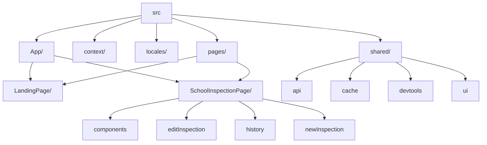

# Welcome to inspector Chalmers - A DHIS2 Platform App

This project was bootstrapped with [DHIS2 Application Platform](https://github.com/dhis2/app-platform).

## Available Scripts

In the project directory, you can run:

### `yarn start`

Runs the app in the development mode.<br />
Open [http://localhost:3000](http://localhost:3000) to view it in the browser.

The page will reload if you make edits.<br />
You will also see any lint errors in the console.

### `yarn test`

Launches the test runner and runs all available tests found in `/src`.<br />

See the section about [running tests](https://platform.dhis2.nu/#/scripts/test) for more information.

### `yarn build`

Builds the app for production to the `build` folder.<br />
It correctly bundles React in production mode and optimizes the build for the best performance.

The build is minified and the filenames include the hashes.<br />
A deployable `.zip` file can be found in `build/bundle`!

See the section about [building](https://platform.dhis2.nu/#/scripts/build) for more information.

### `yarn deploy`

Deploys the built app in the `build` folder to a running DHIS2 instance.<br />
This command will prompt you to enter a server URL as well as the username and password of a DHIS2 user with the App Management authority.<br/>
You must run `yarn build` before running `yarn deploy`.<br />

See the section about [deploying](https://platform.dhis2.nu/#/scripts/deploy) for more information.

## Code Structure Overview

Chalmers is a DHIS2 React Application Platform project. `src/App/App.jsx` handles routing and provides the inspection + attribute contexts used across every page. The app has two main areas: `LandingPage` for search/entry and `SchoolInspectionPage` for viewing history, editing events, and capturing new inspections. 
## App Functionality

Inspector Chalmers is a full offline-capable PWA React application for school inspections. Users navigate through the organizational tree to select schools, view historical inspection data, and submit new inspections or edit existing ones. The app provides aggregate analytics comparing current and previous inspection data across clusters and schools, with graph visualizations and regression analysis.

### Implementation

**Offline Support**: The app implements a comprehensive offline-first architecture using IndexedDB (via `localforage`) for persistent storage. When offline, inspection submissions are queued in an outbox cache (`src/shared/cache/config.js`). The offline detector (`src/shared/cache/useOfflineDetector.jsx`) monitors connection status by checking browser online state, DHIS2 connection status, and server reachability. Data queries use a cacheable query wrapper (`src/shared/cache/cacheableQuery.jsx`) that serves stale cache immediately while fetching fresh data in the background.

**User Experience**: The codebase emphasizes clarity and feedback for users with varying digital literacy. Form validation provides immediate, contextual error messages. Progress indicators show completion status for multi-field forms. Field constraints prevent invalid inputs (e.g., negative numbers, values exceeding limits). Visual signifiers like icons, color-coded states, and clear button labels make actions discoverable. The UI follows DHIS2 design patterns for consistency, using familiar navigation structures and standard components. Loading states and success/error feedback are shown throughout to keep users informed of system status.

### Codebase
Below are two diagrams explaining how the code is structured and distributed in the project.



```
src/
├── App/                       # Routes + top-level setup
├── context/                   # Inspection and attribute contexts
├── locales/                   # Translations
├── pages/
│   ├── LandingPage/          # Landing UI
│   └── SchoolInspectionPage/ # Inspection UI
│       ├── components/       # Org tree + info cards
│       │   ├── OrgTreePanel.{jsx,css}
│       │   └── SchoolInfoCard.{jsx,css}
│       ├── editInspection/   # Edit + delete flows
│       │   ├── hooks/
│       │   │   ├── useUpdateSchoolInspection.jsx
│       │   │   └── useDeleteSchoolInspection.jsx
│       │   ├── EditInspectionForm.{jsx,css}
│       │   └── DeleteInspectionPanel.{jsx,css}
│       ├── history/          # Analytics and trends
│       │   ├── api/          # Data fetchers
│       │   ├── components/   # Timeline + tables
│       │   ├── graphs/       # Charts
│       │   ├── heatmap/      # Heatmap + legend
│       │   └── hooks/        # Aggregated data hooks
│       └── newInspection/    # New inspection flow
│           ├── components/   # Form fields
│           ├── configs/      # Form metadata and icons
│           ├── hooks/        # usePostSchoolInspectionEvent
│           └── SchoolInspectionForm.{jsx,css}
└── shared/
    ├── api/                  # API helpers + docs
    │   ├── datasetsAPI.jsx
    │   ├── useSchoolsAPI.jsx
    │   ├── useTrackerEventMutation.jsx
    │   └── endpoint_diagram.md
    ├── cache/                # Offline + cache helpers + outbox
    │   ├── cacheableQuery.jsx
    │   ├── useOfflineDetector.jsx
    │   └── useOutboxCount.jsx
    ├── dev-tools/            # Mock data scripts - Disabled.
    │   └── populateSchoolInspections.js
    └── ui/                   # Shared UI bits
        └── icons/            # SVG set

```

**Example flow – editing an inspection**

1. `App/App.jsx` renders `SchoolInspectionPage`.
2. `editInspection/EditInspectionForm.jsx` consumes `InspectionContext`.
3. Update/delete hooks (`hooks/useUpdateSchoolInspection.jsx`, `hooks/useDeleteSchoolInspection.jsx`) call shared API primitives.
4. History visualizations under `history/components` refetch analytics through shared hooks to reflect changes.

## Learn More

You can learn more about the platform in the [DHIS2 Application Platform Documentation](https://platform.dhis2.nu/).

You can learn more about the runtime in the [DHIS2 Application Runtime Documentation](https://runtime.dhis2.nu/).

To learn React, check out the [React documentation](https://reactjs.org/).
