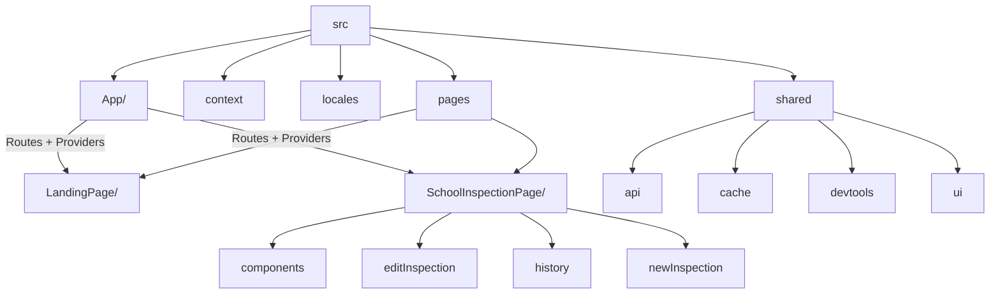

## Inspector Chalmers Code Structure

This document complements the root `README.md` by describing how the application is organized in source control. Use it when you need to navigate the codebase, onboard a new contributor, or explain where to add new features.

### Big Picture

- Built with the DHIS2 Application Platform (React + HashRouter).
- `src/App/App.jsx` wires routing and provides global contexts for inspection data and attribute metadata.
- Two primary user-facing sections:
  - `LandingPage` – entry/search experience.
  - `SchoolInspectionPage` – inspection workflow (history, editing, new submissions).
- Shared infrastructure (API hooks, caching, UI primitives) lives in `src/shared`.

### Structure Diagram

### Folder Reference

| Path | Description |
| --- | --- |
| `src/App/` | Application entry point; configures React Router and wraps the app with `InspectionContext` and `AttributeContext`. |
| `src/context/` | React context definitions for inspection state and attribute metadata shared across pages. |
| `src/locales/` | Translation bundles (`translations.json`) plus locale bootstrap. |
| `src/pages/LandingPage/` | Landing/search UI, including `SchoolSearchBar` and summary metrics (`MetricTile`). Styles are colocated via CSS modules. |
| `src/pages/SchoolInspectionPage/` | Main inspection workflow. Key areas: |
| &nbsp;&nbsp;&nbsp;`components/` | Org tree, school info cards, and shared panels for the inspection view. |
| &nbsp;&nbsp;&nbsp;`editInspection/` | Edit flow UI, hooks for update/delete mutations, and styling. |
| &nbsp;&nbsp;&nbsp;`history/` | Analytics/history visualization with nested areas (`api`, `components`, `graphs`, `heatmap`, `hooks`). |
| &nbsp;&nbsp;&nbsp;`newInspection/` | New inspection form, reusable field components, config definitions, and POST hook. |
| `src/shared/api/` | Abstracted API helpers and documentation (`endpoint_diagram.md`, `mermaid.md`) plus hooks for datasets, schools, and tracker events. |
| `src/shared/cache/` | Utilities that wrap DHIS2 offline/caching primitives (offline detector, outbox count, cacheable queries). |
| `src/shared/dev-tools/` | Development helpers such as `PopulateDataButton` and scripts to seed inspection data. |
| `src/shared/ui/` | Reusable UI utilities (`useEvent`, `useOrgIds`) and icon system (SVG set + `Icon` component). |

### Working Example

When a user edits an inspection:

1. `App/App.jsx` loads `SchoolInspectionPage`.
2. The edit pane (`editInspection/EditInspectionForm.jsx`) consumes `InspectionContext`.
3. Mutations (`hooks/useUpdateSchoolInspection.jsx`, `hooks/useDeleteSchoolInspection.jsx`) rely on shared API helpers.
4. Changes propagate to history visualizations (`history/components/*`) through shared hooks that refetch analytics.

Understanding how each folder feeds into that flow should make it easier to reason about ownership and select the right place for new code.

