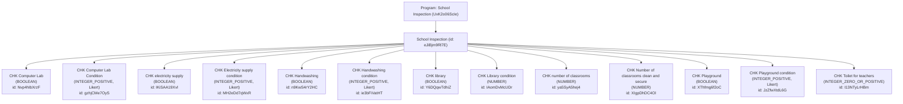
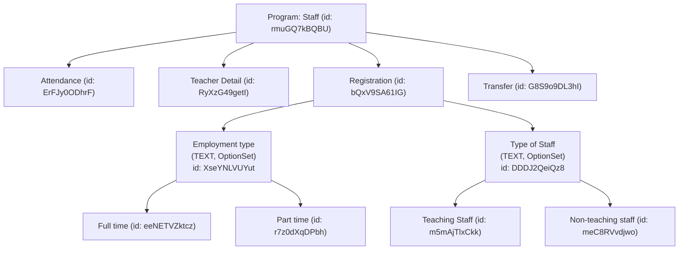
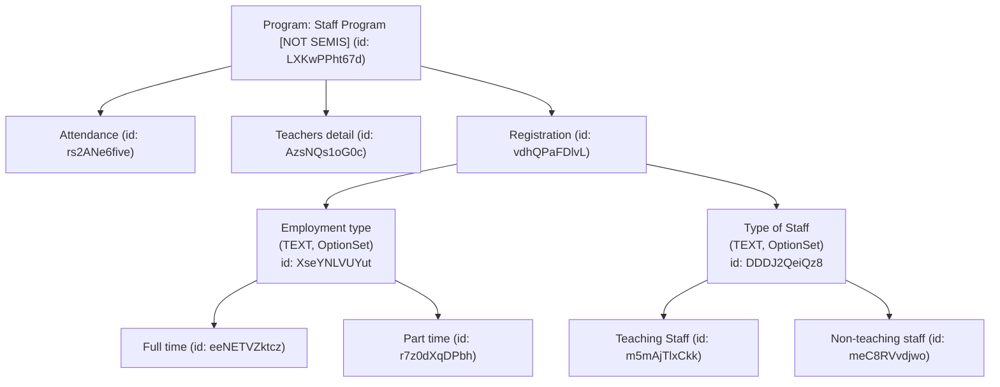
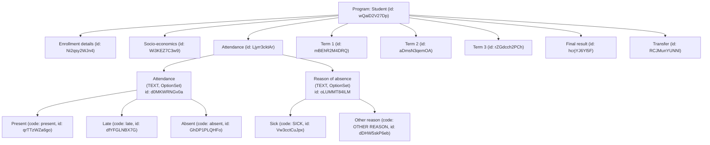
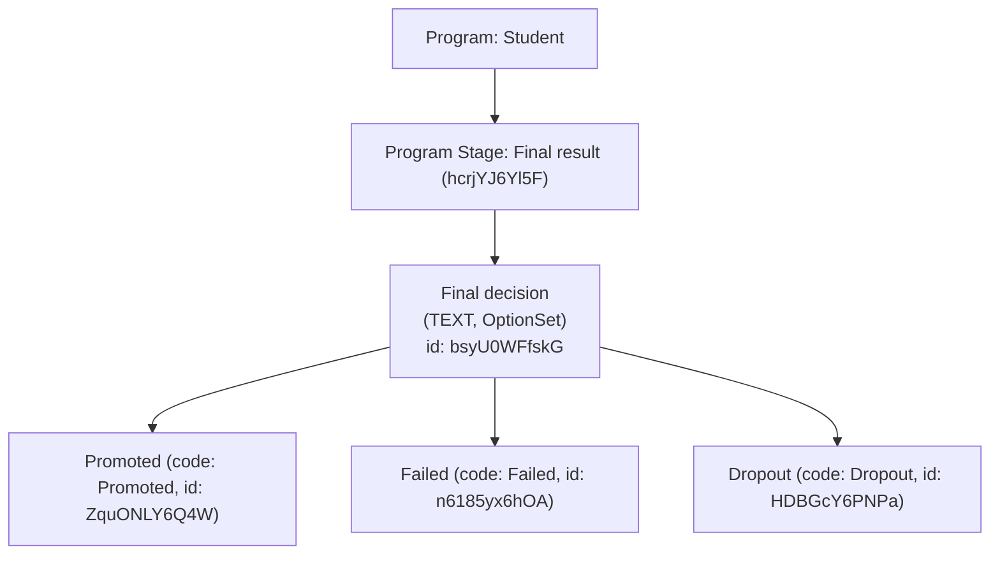

# School Inspection Program


# Staff Program


# Staff Program [NOT SEMIS]


# Student Program

```mermaid
graph TD
  P["Program: Student"]
  S["Program Stage: Enrollment details (Ni2qsy2WJn4)"]

  P --> S

  %% Academic Year
  S --> DE1["Academic year (Short List)<br/>(TEXT, OptionSet)<br/>id: iDSrFrrVgmX"]
  DE1 --> O1a["2025 (code: 2025, id: USos4No00bL)"]
  DE1 --> O1b["2024 (code: 2024, id: EYHPkmo7cp8)"]
  DE1 --> O1c["2023 (code: 2023, id: E4OrJU3BCvb)"]
  DE1 --> O1d["2022 (code: 2022, id: cuphoBJK2Lq)"]
  DE1 --> O1e["2021 (code: 2021, id: PRkd6otBUcJ)"]
  DE1 --> O1f["2020 (code: 2020, id: DdfT3i3gZ81)"]

  %% Grade
  S --> DE2["Grade<br/>(TEXT, OptionSet)<br/>id: kNNoif9gASf"]
  DE2 --> O2a["Grade 1 (id: S9TGHNI8eBF)"]
  DE2 --> O2b["Grade 2 (id: snc9eyX5jgs)"]
  DE2 --> O2c["Grade 3 (id: wYmPxH5v8FL)"]
  DE2 --> O2d["Grade 4 (id: S9othOt7LbW)"]
  DE2 --> O2e["Grade 5 (id: UZMuAoSTHqu)"]
  DE2 --> O2f["Grade 6 (id: W0zT1hs45Lf)"]
  DE2 --> O2g["Grade 7 (id: NFmO5WaKoPD)"]
  DE2 --> O2h["Grade 8 (id: TU7W1KrD05N)"]
  DE2 --> O2i["Grade 9 (id: JMni60IlKLm)"]
  DE2 --> O2j["Grade 10 (id: luPII3LY1k6)"]
  DE2 --> O2k["Grade 11 (id: LTtwWPMxVxG)"]
  DE2 --> O2l["Grade 12 (id: rNqMnyVoK0q)"]

  %% Class / Section
  S --> DE3["Class/Section<br/>(TEXT, OptionSet)<br/>id: RhABRLO2Fae"]
  DE3 --> O3a["Not defined (id: IoezGFf8U4t)"]
  DE3 --> O3b["A (id: ZCwQQpffdDi)"]
  DE3 --> O3c["B (id: xrEUi5460lU)"]
  DE3 --> O3d["C (id: bhTAC5q7M4a)"]
  DE3 --> O3e["D (id: EdxmWJ6Ryoi)"]
  DE3 --> O3f["E (id: TBFj003UKss)"]
  DE3 --> O3g["F (id: elHLKEfB8df)"]
```

```mermaid

graph TD
  P["Program: Student"]
  S["Program Stage: Socio-economics (Wi3KEZ7C3w9)"]

  P --> S

  %% 1. Simple booleans (yes/no)
  S --> DE1["Ate breakfast this morning<br/>(BOOLEAN)<br/>id: nHzaKkxra91"]
  S --> DE2["Ate lunch yesterday<br/>(BOOLEAN)<br/>id: wby9Xctijvm"]
  S --> DE3["Cell phone charged in house<br/>(BOOLEAN)<br/>id: w9v2w2HUqVI"]
  S --> DE4["Living with parents<br/>(BOOLEAN)<br/>id: JDODlu9eDSe"]
  S --> DE5["Played with tablet/smartphone<br/>(BOOLEAN)<br/>id: grR6N1s5XQT"]
  S --> DE6["Student owns tablet/smartphone<br/>(BOOLEAN)<br/>id: cUtMSq7Fx3J"]
  S --> DE7["Water leaks when raining<br/>(BOOLEAN)<br/>id: Nzn69NvVyLa"]

  %% 2. True-only flags (checkboxes)
  S --> DE8["Bicycle in house<br/>(TRUE_ONLY)<br/>id: uIiwygh0gc9"]
  S --> DE9["Electricity in house<br/>(TRUE_ONLY)<br/>id: sLeCSA4UMe5"]
  S --> DE10["Motorcycle in house<br/>(TRUE_ONLY)<br/>id: AJFvw20uzPd"]
  S --> DE11["Private car in house<br/>(TRUE_ONLY)<br/>id: Ogg3uqGI8Ns"]
  S --> DE12["Radio in house<br/>(TRUE_ONLY)<br/>id: He49CPlky8r"]
  S --> DE13["Refrigerator in house<br/>(TRUE_ONLY)<br/>id: Ran6ozxQFB7"]
  S --> DE14["Telephone in house<br/>(TRUE_ONLY)<br/>id: Tz48cJZ5J7Z"]
  S --> DE15["Television in house<br/>(TRUE_ONLY)<br/>id: heCkBg9mlOD"]

  %% 3. Integer counts
  S --> DE16["Brothers attending current school<br/>(INTEGER)<br/>id: e97wFW2e66W"]
  S --> DE17["Brothers attending school<br/>(INTEGER)<br/>id: aC8Pt5IRG1x"]
  S --> DE18["Brothers in compound<br/>(INTEGER)<br/>id: ykqsD8GiMzk"]
  S --> DE19["Sisters attending current school<br/>(INTEGER)<br/>id: JY7QlVnSt1l"]
  S --> DE20["Sisters attending school<br/>(INTEGER)<br/>id: cMdplQqxi5E"]
  S --> DE21["Sisters in compound<br/>(INTEGER)<br/>id: EVY09tZJbbz"]
  S --> DE22["Time spent to reach school<br/>(INTEGER)<br/>id: QM1EXHMh1RI"]

  %% 4. Text + option sets
  %% Floor material
  S --> DE23["Floor of sleep room<br/>(TEXT, OptionSet)<br/>id: JIk5YtcFt7b"]
  DE23 --> O23a["Earth/mud"]
  DE23 --> O23b["Wood"]
  DE23 --> O23c["Stone/brick"]
  DE23 --> O23d["Cement/concrete/tiles"]
  DE23 --> O23e["Other"]
  DE23 --> O23f["Don’t Know"]

  %% Roof material
  S --> DE24["Roof of sleep room<br/>(TEXT, OptionSet)<br/>id: ZqCNLIQ3IdT"]
  DE24 --> O24a["Thatch"]
  DE24 --> O24b["Wood"]
  DE24 --> O24c["Corrugated iron"]
  DE24 --> O24d["Plastic sheets"]
  DE24 --> O24e["Cement/concrete/tiles"]
  DE24 --> O24f["Other"]

  %% Wall material
  S --> DE25["Walls of sleep room<br/>(TEXT, OptionSet)<br/>id: rAzYbJtQ0wX"]
  DE25 --> O25a["Thatch"]
  DE25 --> O25b["Wood"]
  DE25 --> O25c["Corrugated iron"]
  DE25 --> O25d["Stone / burnt bricks"]
  DE25 --> O25e["Cement/concrete"]
  DE25 --> O25f["Sticks/wattle"]
  DE25 --> O25g["Mud / mud bricks"]
  DE25 --> O25h["Other"]
  DE25 --> O25i["Don’t Know"]

  %% Means of travel
  S --> DE26["Means of travel to school<br/>(TEXT, OptionSet)<br/>id: pmnNFDUEmwT"]
  DE26 --> O26a["Walk"]
  DE26 --> O26b["Bicycle"]
  DE26 --> O26c["Personal vehicle"]
  DE26 --> O26d["Public transport"]
  DE26 --> O26e["Horse/donkey cart"]
```









```mermaid

graph TD
  P["Program: Staff (id: rmuGQ7kBQBU)"]

  %% Program Stages
  S1["Teacher Detail (id: RyXzG49getI)"]
  S2["Teacher Detail (id: AzsNQs1oG0c)"]

  P --> S1
  P --> S2

  %% Shared Elements
  S1 --> DE1["Actual Status (TEXT, OptionSet)<br/>id: m9VE4MTRbh7"]
  S2 --> DE1
  DE1 -->|HM| O1a["HM – Head master"]
  DE1 -->|DHM| O1b["DHM – Deputy head master"]
  DE1 -->|G3T| O1c["G3T – Grade III Teacher"]
  DE1 -->|SM| O1d["SM – Senior master"]
  DE1 -->|DP| O1e["DP – Diploma"]
  DE1 --> etc["..."]
  
  S1 --> DE2["Is Teaching (TRUE_ONLY)<br/>id: NHB0B07ehS4"]
  S2 --> DE2

  S1 --> DE3["First Grade Taught (TEXT)<br/>id: KRTLyimTG3o"]
  S2 --> DE3

  S1 --> DE4["Second Grade Taught (TEXT)<br/>id: NKCCwrX7Jqq"]
  S2 --> DE4

  S1 --> DE5["More than 2 Grades Taught (TRUE_ONLY)<br/>id: haPLy1iMg3a"]
  S2 --> DE5

  %% Shift Taught (shared option set)
  S1 --> DE6["Shift Taught (TEXT, OptionSet)<br/>id: xy84YeL6pok"]
  S2 --> DE6
  DE6 -->|morning| O6a["Morning"]
  DE6 -->|afternoon| O6b["Après midi"]
  DE6 -->|double| O6c["Double shift"]

  S1 --> DE7["Weekly Periods (INTEGER_ZERO_OR_POSITIVE)<br/>id: v1aLSzOvuni"]
  S2 --> DE7

  %% Subject Taught (option set)
  S1 --> DE8["Principal Subject Taught (TEXT, OptionSet)<br/>id: tJdKszUl1Qj"]
  S2 --> DE8

  S1 --> DE9["Secondary Subject Taught (TEXT, OptionSet)<br/>id: MoScAo6FvNo"]
  S2 --> DE9
  DE8 -->|ENGL| O8a["English language"]
  DE8 -->|MATH| O8b["Mathematics"]
  DE8 -->|INTS| O8c["Integrated Studies"]
  DE8 --> etcO["..."]

  %% Education Qualification
  S1 --> DE10["Education Qualification / Highest Education Level<br/>(TEXT, OptionSet)<br/>id: euhRQDi96Yz"]
  S2 --> DE10
  DE10 -->|B| O10a["Bachelor"]
  DE10 -->|M| O10b["Masters"]
  DE10 -->|P| O10c["PhD"]

  %% Unique to Stage 1
  S1 --> U1a["Is New Teacher (TRUE_ONLY)<br/>id: UvndXMCkseN"]
  S1 --> U1b["Stays in Quarter (TRUE_ONLY)<br/>id: rUBHDUSRLCe"]
  S1 --> U1c["Designation/Role in School (TEXT, OptionSet)<br/>id: cfoMqPHkQSs"]

  %% Unique to Stage 2
  S2 --> U2a["Highest Professional Level (TEXT)<br/>id: t723UU16dZM"]
  S2 --> U2b["School Level Attached (TEXT)<br/>id: P6lxqOGEAfg"]
  ```
  ```mermaid

graph TD
  P["Program: Student (id: wQaiD2V27Dp)"]

  %% Program Stage
  S["Term 1 (id: mBEhR2M4DRQ)"]
  P --> S

  %% Data Elements
  S --> DE1["Mathematics (INTEGER_ZERO_OR_POSITIVE)<br/>id: qPwGZal50yH"]
  S --> DE2["Science (INTEGER_ZERO_OR_POSITIVE)<br/>id: w75mLLmHYyS"]
  S --> DE3["Visual arts (INTEGER_ZERO_OR_POSITIVE)<br/>id: HFjLxmmXm7t"]
  S --> DE4["History (INTEGER_ZERO_OR_POSITIVE)<br/>id: cTTpaVY6m1Q"]
  ```
```mermaid

graph TD
  P["Program: Student (id: wQaiD2V27Dp)"]

  %% Program Stages
  S1["Term 1 (id: mBEhR2M4DRQ)"]
  S2["Term 2 (id: aDmsN3qemOA)"]
  S3["Term 3 (id: rZGdcch2PCh)"]

  P --> S1
  P --> S2
  P --> S3

  %% Data Elements (shared)
  subgraph Shared Data Elements
    DE1["Mathematics (INTEGER_ZERO_OR_POSITIVE)<br/>id: qPwGZal50yH"]
    DE2["Science (INTEGER_ZERO_OR_POSITIVE)<br/>id: w75mLLmHYyS"]
    DE3["History (INTEGER_ZERO_OR_POSITIVE)<br/>id: cTTpaVY6m1Q"]
    DE4["Visual arts (INTEGER_ZERO_OR_POSITIVE)<br/>id: HFjLxmmXm7t"]
  end

  %% Term 1 links
  S1 --> DE1
  S1 --> DE2
  S1 --> DE3
  S1 --> DE4

  %% Term 2 links
  S2 --> DE1
  S2 --> DE2
  S2 --> DE3
  S2 --> DE4

  %% Term 3 links
  S3 --> DE1
  S3 --> DE2
  S3 --> DE3
  S3 --> DE4
  ```
```mermaid

graph TD
  P["Program: Student (id: wQaiD2V27Dp)"]

  %% Program Stages
  S1["Transfer (id: G8S9o9DL3hI)"]
  S2["Transfer (id: RCJMunYUNNl)"]

  P --> S1
  P --> S2

  %% Common Data Elements
  DE1["Reason for transfer (TEXT, OptionSet: Financial, Health, Others)<br/>id: Wq87Fqgd420"]
  DE2["Transfer status (TEXT, OptionSet: Pending, Approved, Reproved)<br/>id: vpE9A9biU05"]
  DE3A["Destiny School (ORGANISATION_UNIT)<br/>id: D8cYfexBFfG"]

  %% Specific to S1 (first Transfer)
  DE3B["Origin School (ORGANISATION_UNIT)<br/>id: BxOhjC4qCFD"]

  %% Link shared data elements
  S1 --> DE1
  S1 --> DE2
  S1 --> DE3A
  S1 --> DE3B

  S2 --> DE1
  S2 --> DE2
  S2 --> DE3A

```

<!-- # GPT SIER AT VI KAN HENTE UT ANTALL STUDENTER SÅNN /api/analytics/enrollments?program=wQaiD2V27Dp&dimension=ou:<orgUnitId>
https://research.im.dhis2.org/in5320g09/api/tracker/trackedEntities?program=wQaiD2V27Dp&orgUnit=oXTcmBQ3JjJ&fields=trackedEntity&totalPages=true&pageSize=1 -->